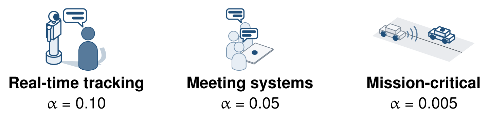
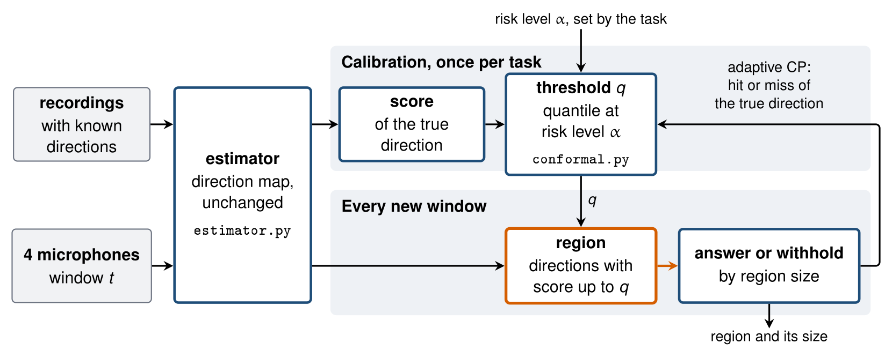
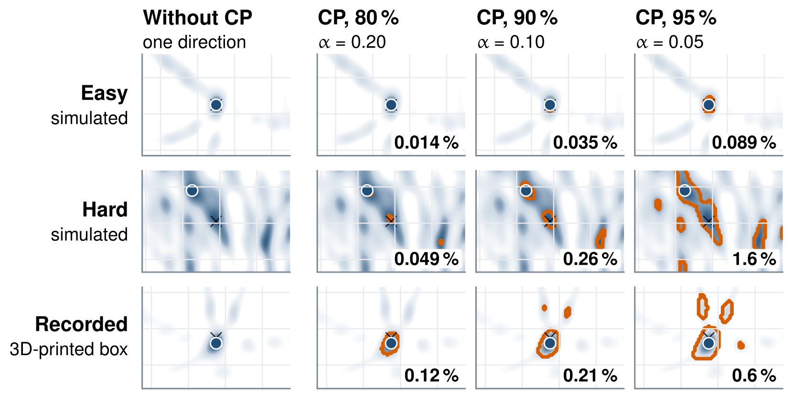
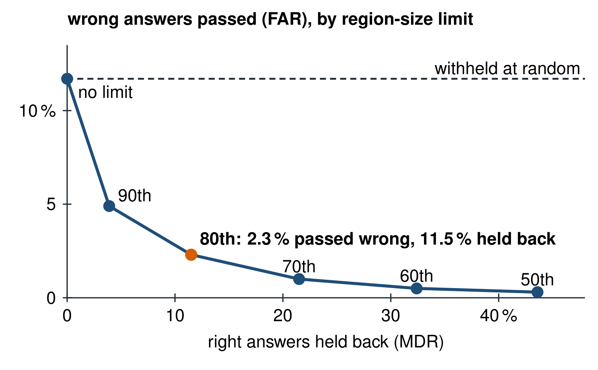
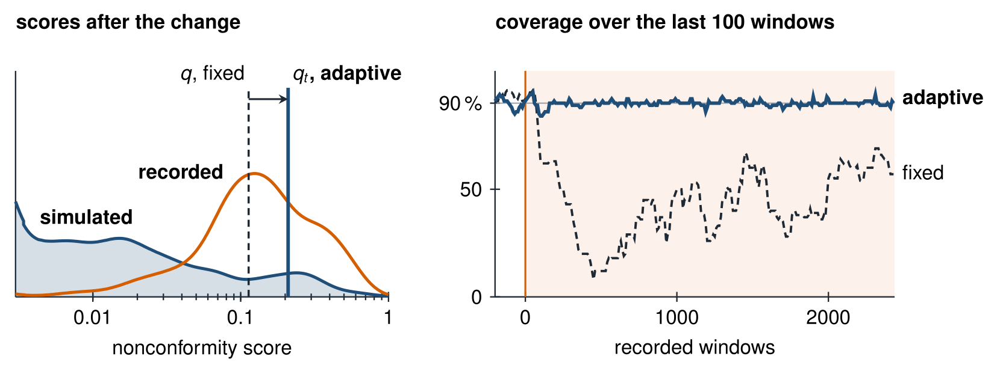
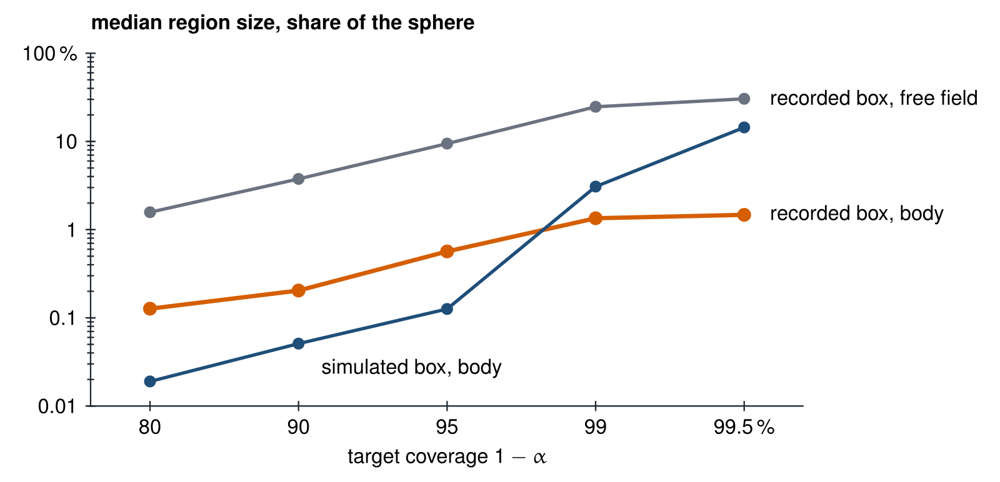

# Conformal Sound Localization

Conformal prediction on top of an unchanged sound source localizer, so that each downstream task sets its own risk level. The direction map becomes a region that holds the true direction with a stated probability, a limit on region size trades false alarms against misses, and an adaptive threshold, updated with the true directions of past windows, keeps the coverage when the noise or the room changes. Research internship at the KIST AI and Robotics Institute, Humanoid Research Center (2026).



On recordings of a 3D-printed box and of the LOCATA robot head, the regions hold the true direction in 89 to 90 % of windows at α = 0.10 and in over 99 % at α = 0.005. At the same coverage, the body's templates give regions 12 to 21 times smaller than free-field templates on the box (0.20 % of the sphere against 3.8 % at α = 0.10). When the conditions move from simulation to the recorded box, the adaptive threshold keeps the coverage at 89.7 %, where a fixed threshold falls to 43.6 %.

**Technical summary**

- **Unchanged localizer.** Conformal prediction only reads direction maps, so the same code runs on the box with its own templates, with free-field templates and on LOCATA.
- **Risk level per task.** The task sets α, and calibration on windows with known directions turns it into a threshold.
- **Answer or abstain.** A limit on region size trades false alarms (FAR) against held-back right answers (MDR).
- **Adaptive threshold.** Adaptive conformal inference, updated with the true directions of past windows, brings the coverage back after a change of noise or room.

## Problem and users

Sound source directions are passed on to other modules, and their tasks weigh errors differently (figure above). Where a wrong direction leads to an accident, the share of passed answers that are wrong (false alarm rate, FAR) must stay low. Where the system has to respond, the share of right answers that are held back (missed detection rate, MDR) is the cost. The localizer's direction map does not say how far to trust its peak, because the same peak height means different things on different bodies and in different rooms, and the noise and the room can change after the system is set up.

## Design requirements

- **Localizer unchanged.** The method reads the localizer's direction maps and changes nothing in it.
- **Risk level per task.** The region holds the true direction with probability at least 1 − α, for an α chosen by the task.
- **FAR against MDR.** The task sets the balance between wrong answers passed and right answers held back.
- **Adaptation.** The coverage holds when the noise or the room changes.

## System architecture



Boxes with a solid colored outline are code in this repository, and gray boxes are inputs.

- **Existing data:** the BEM table, simulated scenes and recordings of the box from [robot-body-sound-localization](https://github.com/Kwon-Junhyeong/robot-body-sound-localization), the public LOCATA corpus.
- **Developed for this project:** the direction-map estimator, the nonconformity score, threshold, region and region size, the answer-or-abstain rule, the adaptive threshold, and the experiments on the box and on LOCATA.

## The localizer stays as it is

`estimator.py` sums the cross-spectra of the six microphone pairs over the frames of a one-second window and keeps their phase. It compares them with templates, the pair cross-spectra that a source in each grid direction would produce, and the sum of the matches over pairs and frequencies is the direction map. On the 3D-printed test box the templates come from the box's boundary element method (BEM) table. On the robot head of the LOCATA recordings they are free-field plane waves for four of its microphones, and each pair is weighted by log(1 + its summed cross-spectrum magnitude).

Calibration on recordings with known directions turns the map into a region with a stated probability, so `conformal.py` only reads maps.

## Calibration sets the threshold



Each map is scaled to [0, 1] within its window, and the nonconformity score of a direction is one minus its scaled value. A calibration window is scored at its known true direction, so its score is high when the localizer put little weight on the truth. With n calibration windows and k = ⌈(n + 1)(1 − α)⌉, the threshold q is the k-th smallest calibration score (the whole grid when k > n). The region of a new window holds every direction whose score is at most q. When the calibration windows and the new window are exchangeable, the region holds the true direction with probability at least 1 − α over windows (marginal coverage).

Each recording goes wholly to calibration or to test, because the windows of one recording share the source, the room and the array. Region size is the share of the grid's solid angle that the region covers: the whole sphere for the box and elevations within ±80° for LOCATA. Weighting by solid angle keeps the dense rows near the poles of an azimuth-elevation grid from being overcounted. In the figure, the dot is the peak of the map and the cross the true direction. The regions of the hard scene and of the recorded window grow from 0.049 % to 1.6 % and from 0.12 % to 0.6 % of the sphere as the stated probability rises from 80 % to 95 %.

## Answer or abstain



`conformal.answer` withholds the direction estimate when its region is larger than a limit set on the calibration windows, a percentile of their region sizes. This limit is the task's second setting: a lower limit passes fewer wrong answers and holds back more right ones. FAR is the share of passed answers whose map peak is off by more than a bound, and MDR the share of right answers that are withheld. The figure shows the simulated scenes at α = 0.10 with a bound of 5°.

## Adaptive threshold



The guarantee of a fixed threshold assumes that new windows are exchangeable with the calibration windows, and a change of noise or room breaks that. `conformal.AdaptiveCP` runs adaptive conformal inference (Gibbs and Candès, 2021). The working level starts at α, and once the true direction of window t is known it moves by $\alpha_{t+1} = \alpha_t + \gamma(\alpha - \text{miss}_t)$, where $\text{miss}_t$ is 1 if the region missed it and 0 if not. A miss lowers the level and enlarges the next regions, and a hit shrinks them a little. In the figure, the threshold is calibrated on simulated scenes and the stream moves to the recorded box: the scores of the recorded windows are higher, the adaptive threshold moves up to them, and the coverage stays near 90 %.

## Results

**Coverage.** Coverage is the share of test windows whose region holds the true direction, averaged over 100 random splits that send half of the recordings to calibration (`run_split.py`).

| Data | Templates | Windows (recordings) | Median error of the map peak | Coverage, α = 0.10 | α = 0.05 | α = 0.005 | Median region size, α = 0.10 |
|---|---|---|---|---|---|---|---|
| Simulated box scenes | body (BEM) | 600 (600) | 0.75° | 89.8 % | 94.9 % | 99.7 % | 0.05 % |
| Recorded box | body (BEM) | 2,437 (264) | 3.04° | 89.4 % | 94.5 % | 99.1 % | 0.20 % |
| Recorded box | free field | 2,437 (264) | 5.01° | 89.8 % | 94.7 % | 99.2 % | 3.8 % |
| LOCATA robot head | free field | 782 (32) | 10.1° | 90.3 % | 94.7 % | 99.4 % | 3.5 % |

The simulated scenes are one-second, four-channel scenes of the box in random rooms, with a reverberation time of 0.2 to 1.3 s and noise at a signal-to-noise ratio (SNR) of −5 to 15 dB, synthesized as in robot-body-sound-localization. The recorded box was recorded from 264 directions. LOCATA is the robot head (benchmark2), tasks 1, 3 and 5. On the recorded box, from α = 0.10 to 0.005 the median region grows from 0.20 % to 1.5 % of the sphere with the body's templates, and from 3.8 % to 30 % with free-field templates: at every level the body's templates give regions 12 to 21 times smaller at the same coverage.



**Answer or abstain** at α = 0.10, same splits:

| Region size limit | Simulated box: answered | FAR, over 5° | MDR | Recorded box, free field: answered | FAR, over 10° | MDR |
|---|---|---|---|---|---|---|
| 90th percentile | 89.4 % | 4.9 % | 3.9 % | 89.8 % | 22.3 % | 1.5 % |
| 80th percentile | 80.0 % | 2.3 % | 11.5 % | 80.3 % | 15.4 % | 4.1 % |
| 70th percentile | 70.1 % | 1.0 % | 21.5 % | 70.5 % | 7.8 % | 8.3 % |
| 60th percentile | 60.0 % | 0.5 % | 32.4 % | 61.1 % | 1.1 % | 14.6 % |

Without the limit the FAR is 11.5 % and 29.5 %, and withholding as many windows at random leaves it there. The recorded box uses free-field templates here; with the body's templates no error exceeds 10°.

**Change of noise or room.** α = 0.10, γ = 0.02, true directions from the dataset labels (`run_stream.py`).

| Stream after calibration | Coverage, fixed | Coverage, adaptive | Median region size, fixed | Median region size, adaptive |
|---|---|---|---|---|
| LOCATA, white noise at 5 dB SNR | 89.9 % | 89.9 % | 2.6 % | 2.2 % |
| LOCATA, white noise at 0 dB SNR | 76.4 % | 89.4 % | 2.0 % | 3.9 % |
| LOCATA, white noise at −5 dB SNR | 42.2 % | 88.7 % | 1.3 % | 11.3 % |
| Recorded box after simulated scenes | 43.6 % | 89.7 % | 0.04 % | 0.10 % |

For LOCATA the threshold is calibrated on the 235 windows of the development set, and each stream is the 547 windows of the evaluation set as recorded, then the same windows with white noise; the row reports the noisy part. For the recorded box the threshold is calibrated on half of the 600 simulated scenes, and the stream is the other half (fixed 92.3 %, adaptive 90.3 %), then the 2,437 recorded windows with the same body templates; the row reports the recorded part. With the fixed threshold the change shows up as misses. The adaptive threshold restores the coverage by enlarging the regions, from 1.3 % to 11.3 % of the sphere at −5 dB, so the downstream module sees the change as uncertainty.

## Repository structure

| Path | Contents |
|---|---|
| `estimator.py` | Direction maps from pair cross-spectra and templates |
| `windows.py` | One-second windows of the simulated scenes or of LOCATA, with optional added noise |
| `make_maps.py` | Maps of all windows with a BEM table, a free-field table or free-field plane waves |
| `conformal.py` | Nonconformity score, threshold, region, region size, answer or abstain, adaptive threshold |
| `run_split.py` | Coverage, region size, FAR and MDR over random calibration and test splits |
| `run_stream.py` | Fixed and adaptive thresholds on a stream |
| `docs/` | Figures |

## Setup and run

Software: Python 3 with the packages in `requirements.txt`. Inputs: the BEM tables, simulated scenes and box recordings of robot-body-sound-localization, and the LOCATA corpus.

```sh
pip install -r requirements.txt

# simulated scenes of the box (wav and npz pairs)
python windows.py scenes SCENES scenes.npz --list SCENE_LIST
python make_maps.py scenes.npz maps_sim.npz --table BEM_TABLE.h5 --synthetic
python run_split.py maps_sim.npz

# recorded box: one-second windows where the loudspeaker is active
python make_maps.py BOX_WINDOWS.npz maps_box.npz --table BEM_TABLE.h5
python make_maps.py BOX_WINDOWS.npz maps_box_ff.npz --table FREE_FIELD_TABLE.h5
python run_split.py maps_box_ff.npz
python run_stream.py --cal maps_sim.npz --hold-out 0.5 --stream maps_box.npz

# LOCATA
python windows.py locata LOCATA locata.npz
python windows.py locata LOCATA locata_0dB.npz --snr 0
python make_maps.py locata.npz maps_locata.npz --free-field --log-weight
python make_maps.py locata_0dB.npz maps_locata_0dB.npz --free-field --log-weight
python run_split.py maps_locata.npz
python run_stream.py --cal maps_locata.npz:dev --stream maps_locata.npz:eval maps_locata_0dB.npz
```
